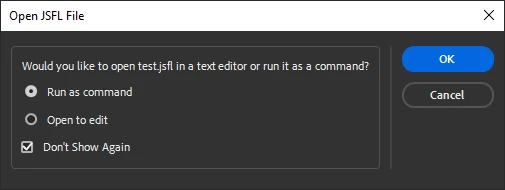
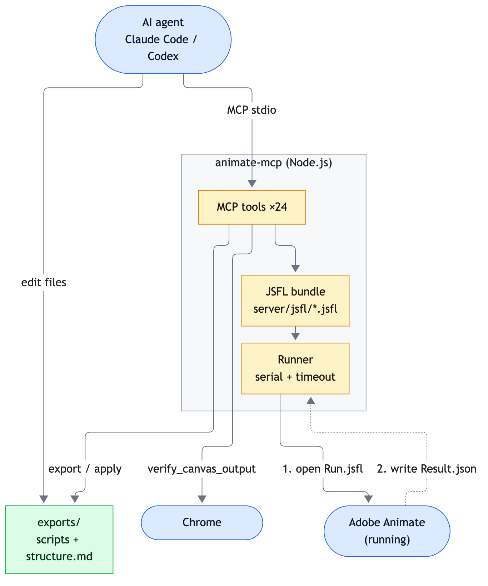

<div align="center">


# animate-mcp

AI エージェントから Adobe Animate を操作するための MCP サーバー

[English](README.md) | 日本語

[変更履歴](CHANGELOG.md)

---

[](https://github.com/gekkyo/animate-mcp/actions/workflows/ci.yml)
[](https://modelcontextprotocol.io)
[](https://www.npmjs.com/package/animate-mcp)
[](https://www.npmjs.com/package/animate-mcp)
[](LICENSE)

</div>

---

## 概要

`animate-mcp` は、Claude CodeやCodexなどのAIエージェントからAdobe Animateを直接操作できるMCPサーバーです。

AIに自然な言葉で指示するだけで、フレームスクリプトの編集やアニメーションの操作、繰り返し作業の自動化ができます。

シーンやライブラリシンボルの構造・スクリプトを読み取り、既存の内容を理解したうえで編集できるほか、レイヤーやフレーム、トゥイーン、インスタンスのプロパティ、ライブラリ内のアセットなど、幅広い操作に対応しています。さらに、ドキュメントのパブリッシュやフレームのPNG画像取得も可能です。

## 主な機能

- シーン・ライブラリシンボルの構造とフレームスクリプトの読み込み・編集
- レイヤー、キーフレーム、インスタンス、テキスト、トゥイーンの確認・編集
- ライブラリの整理、素材の取り込み、シンボルの作成・配置、ステージ設定
- 使われていないライブラリ項目・中身のないキーフレーム等のチェック
- AS3／HTML5 Canvas の Publish、AS3 のコンパイル診断・Test Movie（起動直後の出力を取得）
- Canvas 出力の Chrome での確認、フレームの PNG 取得・差分比較
- GreenSock-AS3 の導入（保存済み AS3 のみ・ライセンス確認が必要）、任意の JSFL の実行

## 動作環境

- Node.js
- Adobe Animate（起動しておく必要があります）
- MCP 対応のクライアント（Claude Code、Claude Desktop など）
- Animate 2027 / Mac / Windows

## インストール

まず [Node.js](https://nodejs.org/ja) をインストールしてください。
インストール後、以下を参考に各クライアントの設定をしてください。

### Claude Code

    claude mcp add animate-mcp -- npx -y animate-mcp@latest

### JSON で設定するクライアント（Claude Desktop など）

    {
      "mcpServers": {
        "animate-mcp": {
          "command": "npx",
          "args": ["-y", "animate-mcp@latest"]
        }
      }
    }

## 使い方

1. Animate を起動し、対象の .fla を開きます。


2. エージェントに作業を依頼します。
   初回の JSFL 実行時に次の確認ダイアログが表示されたら、「コマンドとして実行」を選び、「次回以降表示しない」にチェックを入れて「OK」を押してください。<br><br>

   


3. スクリプトを編集する操作は、次の順に動きます。
    1. `export_scripts` が構造と全フレームスクリプトを `~/.animate-mcp/exports/<ドキュメント名>/` に書き出します。
    2. エージェントがファイルを編集します。
    3. `apply_scripts` が Animate に書き戻します。

### プロンプト例

#### スクリプト操作

```text
開いているドキュメントのスクリプトを書き出して、エラーの原因を調べて
```

#### スクリプト編集

```text
シーン1の1フレーム目のスクリプトに stop() を追加して反映して
```

#### タイムライン確認

```text
シーン1の『キャラ』レイヤーの12フレーム目にあるインスタンスとトゥイーンを確認して
```

#### レイヤーとフレーム編集

```text
シーン1に『背景』レイヤーを追加して、24フレーム分に延ばして
```

#### トゥイーン作成

```text
シーン1の『ボール』インスタンスを1〜24フレームで右へ200px動かし、イーズに backOut（少し行き過ぎて戻る）を使って
```

#### テキストの追加

```text
シーン1の『テキスト』レイヤーの30フレーム目に、48pt・太字で「GAME OVER」というテキストを追加して
```

#### シンボル化

```text
シーン1の1フレーム目の『ボール』を、ムービークリップ ball_mc に変換して
```

#### インスタンスのプロパティ編集

```text
シーン1の1フレーム目の『ボール』インスタンスを透明度50%にして、ぼかしフィルターを付けて
```

#### ステージ設定の変更

```text
ステージを 1280×720、30fps、背景を黒にして
```

#### 素材の取り込み

```text
/path/to/hero.png と /path/to/bgm.mp3 をライブラリに取り込んで
```

#### Publish

```text
開いているドキュメントを Publish して、コンパイルエラーを教えて
```

#### Test Movie

```text
開いている AS3 ドキュメントを Test Movie で実行して、コンパイルエラーと起動直後の出力を教えて
```

#### Canvas 出力の確認

```text
Canvas 出力を Chrome で開いて、コンソールエラーがないか確認して
```

既定で Publish して出力を上書きします。既存の出力で確認するだけなら「Publish せずに」と指示してください。

#### フレームの取得

```text
シーン1の12フレーム目を画像で取得して、見た目を教えて
```

#### ライブラリ整理

```text
ライブラリの未使用アイテムを一覧にして
```

#### GreenSock 導入

```text
保存済みの AS3 ドキュメントに GreenSock-AS3 を導入して（ライセンスは確認済み）
```

## 利用時のポイント

- 複数のドキュメントを開いている場合は、対象を指定してください。
- スクリプトの編集では Export → 編集 → Apply の順に処理を行います。Export 後に Animate 側を変更した場合や、タイムライン・ライブラリを変更した後は、再 Export が必要です。
- 編集後の `.fla` は自動では保存されません。`save_document` か Animate の保存操作を使ってください。

## ツール

### 公開している MCP ツール

既定で公開する MCP ツールは次の4つです。

| MCP ツール | 用途 |
|------------|------|
| `search_tools` | 操作のスキーマ・注意点を検索 |
| `execute_readonly` | 読み取り専用の操作を実行 |
| `execute_write` | それ以外の操作を実行（読み取り専用の操作は拒否） |
| `run_jsfl` | JSFL を直接実行（個別に禁止可能） |

許可は `execute_readonly` / `execute_write` 単位です。「常に許可」はその入口の対象すべてに適用されます。以前の個別操作名の権限ルールは一致しません。操作の一覧と詳細は [TOOLS.ja.md](TOOLS.ja.md) を参照してください。

### 操作一覧

次の操作は独立した MCP ツールではなく、`execute_readonly` / `execute_write` の `name` に指定して実行します。

| 分類 | 操作 | できること |
|------|--------|------------|
| ドキュメント | `get_document_info` | 名前・サイズ・フレームレート・AS バージョンを確認 |
|  | `get_status` | Animate の応答と開いているドキュメントを確認 |
|  | `open_document` | `.fla` を開く／新規ドキュメントを作成 |
|  | `save_document` | ドキュメントを保存 |
|  | `close_document` | 保存せずにドキュメントを閉じる |
|  | `set_document_properties` | ステージサイズ・フレームレート・背景色を変更 |
|  | `audit_document` | 未使用のライブラリ項目や空キーフレームを一覧化 |
| スクリプト | `export_scripts` | フレームスクリプトと構造をファイルに書き出す |
|  | `apply_scripts` | 編集したスクリプトを Animate に反映 |
| タイムライン・要素 | `inspect_timeline` | レイヤー・キーフレーム・インスタンス・トゥイーンと任意の幾何情報を確認 |
|  | `edit_timeline` | レイヤー・フレーム・キーフレーム・ラベルを編集 |
|  | `edit_tween` | トゥイーンの作成とイージング変更 |
|  | `edit_elements` | シンボルインスタンスの編集・配置 |
|  | `edit_text` | テキストの追加・編集 |
|  | `convert_to_symbol` | 要素をシンボルに変換 |
| ライブラリ | `edit_library` | 整理・使用箇所の検索・AS3 リンケージ編集 |
|  | `import_assets` | 画像・音声をライブラリに取り込む |
| 出力・確認 | `publish` | Publish して Build result を返す |
|  | `get_air_descriptor` | AIR アプリ設定を隣接または指定した descriptor から取得 |
|  | `set_air_descriptor` | 隣接または指定した descriptor の AIR アプリ設定を編集 |
|  | `preflight_publish` | Publish せずに事前確認（AIR の descriptor・アイコンを含む） |
|  | `read_output` | Output / Compiler Errors パネルを読む |
|  | `test_movie` | AS3 の Test Movie を実行してコンパイル診断と起動直後の出力を取得 |
|  | `verify_canvas_output` | Canvas 出力を Chrome で開いてエラーを確認 |
|  | `capture_frame` | フレームまたは範囲を PNG で取得 |
|  | `diff_captures` | キャプチャ PNG 2枚を比較 |
|  | `visual_regression` | 名前付きフレーム基準画像を保存・比較 |
| その他 | `install_greensock` | GreenSock-AS3 を導入（保存済み AS3 のみ・ライセンス確認が必要） |

## 環境変数

| 名前                          | 内容                                 | 既定値                |
|-------------------------------|--------------------------------------|-----------------------|
| `ANIMATE_MCP_TIMEOUT_MS`      | 実行タイムアウト                     | 30000                 |
| `ANIMATE_MCP_RUNS_DIR`        | 作業ディレクトリ                     | `~/.animate-mcp/runs` |
| `ANIMATE_MCP_LAUNCH_COMMAND`  | `.jsfl` を開くための独自起動コマンド | OS 既定               |
| `ANIMATE_MCP_PROCESS_PATTERN` | 起動判定用の独自プロセスパターン     | OS 既定               |

## 仕組み

<div align="center">
  <picture>
    <source media="(prefers-color-scheme: dark)" srcset="assets/architecture-dark.png">
    
  </picture>
</div>

各ツールは JSFL スクリプトを生成して `~/.animate-mcp/runs/` に書き出し、起動中の Animate で開いて実行します。スクリプトは結果を JSON で書き出し、サーバーがそれを読み取ります。実行は直列で、Animate が応答しない場合はタイムアウトします。

## 不具合報告

[Issues](https://github.com/gekkyo/animate-mcp/issues) へお願いします。Animate のバージョン、OS、再現手順、エラーメッセージを添えてください。

## 開発

リポジトリのルートで依存関係をインストールし、ビルドとテストを実行します。

    npm install && npm run build
    npm test

ビルドしたサーバーを MCP クライアントに登録する場合は、起動コマンドを `node /path/to/animate-mcp/server/dist/index.js` に設定します。`/path/to/animate-mcp` は実際のリポジトリのパスに置き換えてください。

クライアントへの登録なしに、ビルドしたサーバーの操作を1回試すには、リポジトリのルートで次を実行します（`get_status` の例）。

    npm run -s call -- execute_readonly '{"name":"get_status","arguments":{}}'

実機 Animate を使うリリース前の確認は、[スモークテスト](SMOKE_TESTS.ja.md)を参照してください。

## ライセンス

[MIT ライセンス](LICENSE)
