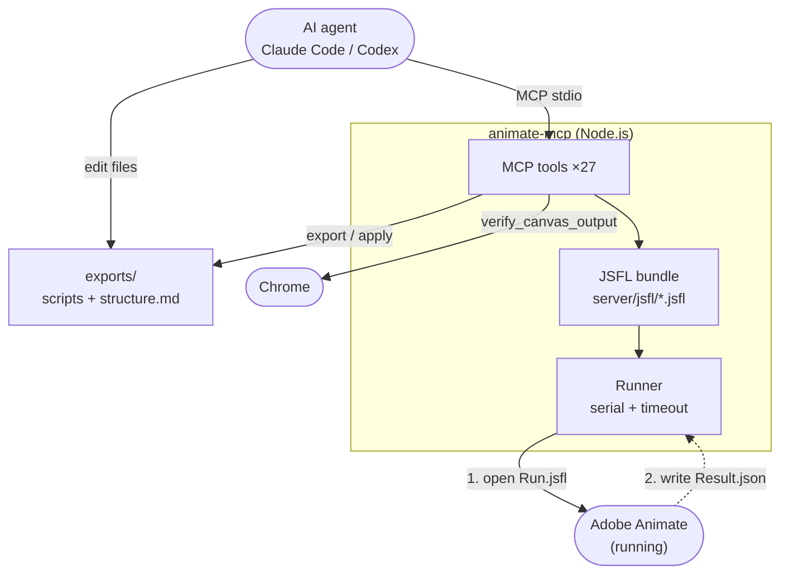

<div align="center">

# animate-mcp

AI エージェントから Adobe Animate を操作するための MCP サーバー

[English](README.md) | 日本語

[変更履歴](CHANGELOG.md)

[](https://github.com/gekkyo/animate-mcp/actions/workflows/ci.yml)
[](https://modelcontextprotocol.io)
[](https://www.npmjs.com/package/animate-mcp)
[](LICENSE)

</div>

---

## 概要

`animate-mcp` は、Claude CodeやCodexなどのAIエージェントからAdobe Animateを直接操作できるMCPサーバーです。

AIに自然な言葉で指示するだけで、フレームスクリプトの編集やアニメーションの操作、繰り返し作業の自動化ができます。

シーンやライブラリシンボルの構造・スクリプトを読み取り、既存の内容を理解したうえで編集できるほか、レイヤーやフレーム、トゥイーン、インスタンスのプロパティ、ライブラリ内のアセットなど、幅広い操作に対応しています。さらに、ドキュメントのパブリッシュやフレームのPNG画像取得も可能です。

## 主な機能

- シーン・ライブラリシンボルの構造とフレームスクリプトの読み込み・編集
- レイヤー、キーフレーム、インスタンス、テキスト、トゥイーンの確認・編集
- ライブラリの整理、素材の取り込み、シンボルの作成・配置、ステージ設定
- 使われていないライブラリ項目・中身のないキーフレーム等のチェック
- AS3／HTML5 Canvas の Publish、AS3 のコンパイル診断・Test Movie（起動直後の出力を取得）
- Canvas 出力の Chrome での確認、フレームの PNG 取得・差分比較
- GreenSock-AS3 の導入（保存済み AS3 のみ・ライセンス確認が必要）、任意の JSFL の実行

## 動作環境

- Node.js
- Adobe Animate（起動しておく必要があります）
- MCP 対応のクライアント（Claude Code、Claude Desktop など）
- Animate 2027 / Mac / Windows

## インストール

### Claude Code

    claude mcp add animate-mcp -- npx -y animate-mcp@latest

### JSON で設定するクライアント（Claude Desktop など）

    {
      "mcpServers": {
        "animate-mcp": {
          "command": "npx",
          "args": ["-y", "animate-mcp@latest"]
        }
      }
    }

## 使い方

1. Animate を起動し、対象の .fla を開きます。
2. エージェントに作業を依頼します。
3. スクリプトを編集する場合は、次の順に動きます。
    1. `export_scripts` が構造と全フレームスクリプトを `~/.animate-mcp/exports/<ドキュメント名>/` に書き出します。
    2. エージェントがファイルを編集します。
    3. `apply_scripts` が Animate に書き戻します。

### プロンプト例

#### スクリプト操作

```text
開いているドキュメントのスクリプトを書き出して、エラーの原因を調べて
```

#### スクリプト編集

```text
シーン1の1フレーム目のスクリプトに stop() を追加して反映して
```

#### タイムライン確認

```text
シーン1の『キャラ』レイヤーの12フレーム目にあるインスタンスとトゥイーンを確認して
```

#### レイヤーとフレーム編集

```text
シーン1に『背景』レイヤーを追加して、24フレーム分に延ばして
```

#### トゥイーン作成

```text
シーン1の『ボール』インスタンスを1〜24フレームで右へ200px動かし、イーズに backOut（少し行き過ぎて戻る）を使って
```

#### テキストの追加

```text
シーン1の『テキスト』レイヤーの30フレーム目に、48pt・太字で「GAME OVER」というテキストを追加して
```

#### シンボル化

```text
シーン1の1フレーム目の『ボール』を、ムービークリップ ball_mc に変換して
```

#### インスタンスのプロパティ編集

```text
シーン1の1フレーム目の『ボール』インスタンスを透明度50%にして、ぼかしフィルターを付けて
```

#### ステージ設定の変更

```text
ステージを 1280×720、30fps、背景を黒にして
```

#### 素材の取り込み

```text
/path/to/hero.png と /path/to/bgm.mp3 をライブラリに取り込んで
```

#### Publish

```text
開いているドキュメントを Publish して、コンパイルエラーを教えて
```

#### Test Movie

```text
開いている AS3 ドキュメントを Test Movie で実行して、コンパイルエラーと起動直後の出力を教えて
```

#### Canvas 出力の確認

```text
Canvas 出力を Chrome で開いて、コンソールエラーがないか確認して
```

既定で Publish して出力を上書きします。既存の出力で確認するだけなら「Publish せずに」と指示してください。

#### フレームの取得

```text
シーン1の12フレーム目を画像で取得して、見た目を教えて
```

#### ライブラリ整理

```text
ライブラリの未使用アイテムを一覧にして
```

#### GreenSock 導入

```text
保存済みの AS3 ドキュメントに GreenSock-AS3 を導入して（ライセンスは確認済み）
```

## 利用時のポイント

- 複数のドキュメントを開いている場合は、対象を指定してください。
- Export 後に Animate 側を変更すると、Apply 時に競合を検出します。ライブラリを変更した場合は Apply できません。
- 未反映の編集があると再 Export はできません。破棄してよい場合に限り `force: true` を使ってください。
- タイムライン・トゥイーン・ライブラリを変更した後は、スクリプトを編集・適用する前に再 Export してください。
- レイヤー・フレーム・ライブラリアイテムの削除には `confirm: true` が必要です。使用中のライブラリアイテムは削除できません。
- 保存には `save_document`（上書き時は事前に確認）か Animate の保存操作を使います。`edit_library` の `getLinkage` と `setLinkage` で AS3 のリンケージを読み書きできます。アイテムの名前変更・移動によって、リンケージ名やコード内の文字列参照が自動更新されるわけではありません。
- `edit_elements` はトゥイーン途中のフレームを拒否し、書き込み前に全操作を検証します。`.fla` は保存されません。

## ツール

引数や注意点の詳細は [TOOLS.ja.md](TOOLS.ja.md) を参照してください。

| 分類 | ツール | できること |
|------|--------|------------|
| ドキュメント | `get_document_info` | 名前・サイズ・フレームレート・AS バージョンを確認 |
|  | `get_status` | Animate の応答と開いているドキュメントを確認 |
|  | `open_document` | `.fla` を開く／新規ドキュメントを作成 |
|  | `save_document` | ドキュメントを保存 |
|  | `close_document` | 保存せずにドキュメントを閉じる |
|  | `set_document_properties` | ステージサイズ・フレームレート・背景色を変更 |
|  | `audit_document` | 未使用のライブラリ項目や空キーフレームを一覧化 |
| スクリプト | `export_scripts` | フレームスクリプトと構造をファイルに書き出す |
|  | `apply_scripts` | 編集したスクリプトを Animate に反映 |
| タイムライン・要素 | `inspect_timeline` | レイヤー・キーフレーム・インスタンス・トゥイーンと任意の幾何情報を確認 |
|  | `edit_timeline` | レイヤー・フレーム・キーフレーム・ラベルを編集 |
|  | `edit_tween` | トゥイーンの作成とイージング変更 |
|  | `edit_elements` | シンボルインスタンスの編集・配置 |
|  | `edit_text` | テキストの追加・編集 |
|  | `convert_to_symbol` | 要素をシンボルに変換 |
| ライブラリ | `edit_library` | 整理・使用箇所の検索・AS3 リンケージ編集 |
|  | `import_assets` | 画像・音声をライブラリに取り込む |
| 出力・確認 | `publish` | Publish して Build result を返す |
|  | `preflight_publish` | Publish せずに事前確認 |
|  | `read_output` | Output / Compiler Errors パネルを読む |
|  | `test_movie` | AS3 の Test Movie を実行してコンパイル診断と起動直後の出力を取得 |
|  | `verify_canvas_output` | Canvas 出力を Chrome で開いてエラーを確認 |
|  | `capture_frame` | フレームまたは範囲を PNG で取得 |
|  | `diff_captures` | キャプチャ PNG 2枚を比較 |
|  | `visual_regression` | 名前付きフレーム基準画像を保存・比較 |
| その他 | `install_greensock` | GreenSock-AS3 を導入（保存済み AS3 のみ・ライセンス確認が必要） |
|  | `run_jsfl` | 任意の JSFL を実行 |

## 環境変数

| 名前                          | 内容                                 | 既定値                |
|-------------------------------|--------------------------------------|-----------------------|
| `ANIMATE_MCP_TIMEOUT_MS`      | 実行タイムアウト                     | 30000                 |
| `ANIMATE_MCP_RUNS_DIR`        | 作業ディレクトリ                     | `~/.animate-mcp/runs` |
| `ANIMATE_MCP_LAUNCH_COMMAND`  | `.jsfl` を開くための独自起動コマンド | OS 既定               |
| `ANIMATE_MCP_PROCESS_PATTERN` | 起動判定用の独自プロセスパターン     | OS 既定               |

## 仕組み



各ツールは JSFL スクリプトを生成して `~/.animate-mcp/runs/` に書き出し、起動中の Animate で開いて実行します。スクリプトは結果を JSON で書き出し、サーバーがそれを読み取ります。実行は直列で、Animate が応答しない場合はタイムアウトします。

## 不具合報告

[Issues](https://github.com/gekkyo/animate-mcp/issues) へお願いします。Animate のバージョン、OS、再現手順、エラーメッセージを添えてください。

## 開発

    npm install && npm run build
    npm test

クライアント設定: `node /path/to/animate-mcp/server/dist/index.js`（stdio）。

### スモークテスト（実機の Animate）

下記のスクリプトでは確認できない手動チェック:

1. ドキュメントを開いた状態で `fl.trace('hi'); 'ok'` を `run_jsfl` で実行します。出力パネルに `hi` が表示され、ツールは `"ok"` を返します。Animate が前面に出ます（既知の挙動）。
2. `get_document_info` を実行します。名前、サイズ、フレームレート、タイムライン名が返ります。
3. すべてのドキュメントを閉じて `get_document_info` を実行します。"No document open" が返ります。
4. Animate を終了して `run_jsfl` を実行します。"Animate not running" が返ります。

スクリプトでの検証: `npm run build` の後、Animate を起動して、下記のスクリプトを `node server/scripts/<スクリプト>` で実行します。

多くのスクリプトは使い捨ての FLA を作成して操作し、クローズします。手持ちのドキュメントには触れません。例外は `smoke-publish.mjs` で、名前を渡したドキュメントを Publish します。

| スクリプト | 確認内容 | 備考 |
| --- | --- | --- |
| `smoke-publish.mjs <name.fla>...` | `publish` | 開いているドキュメントを使用 |
| `smoke-capture-frame.mjs` | `capture_frame` | 使い捨ての FLA |
| `smoke-edit-elements.mjs` | レイヤー・フレーム・トゥイーン・インスタンスの編集 | 使い捨ての FLA |
| `smoke-edit-library.mjs` | ライブラリの編集 | 使い捨ての AS3 FLA |
| `smoke-edit-text.mjs` | `edit_text` | 使い捨ての AS3・HTML5 Canvas FLA |
| `smoke-import-document-properties.mjs` | 素材の取り込み・ステージ設定 | 使い捨ての FLA |
| `smoke-document-ops.mjs` | open・save・close | 使い捨ての保存済み AS3 FLA |
| `smoke-canvas.mjs` | HTML5 Canvas 機能 | 使い捨ての保存済み FLA |
| `smoke-isolated-publish.mjs` | `publish` と出力 | 使い捨ての保存済み AS3 FLA。Animate は事前に起動しておく |
| `smoke-verification-tools.mjs` | `audit_document`・`verify_canvas_output`・`capture_frame`・`diff_captures` | 使い捨ての保存済み FLA |
| `smoke-test-movie.mjs` | `test_movie` | 使い捨ての AS3 FLA。**Test Movie Player は開いたままなので手動で閉じる** |

## ライセンス

[MIT ライセンス](LICENSE)
