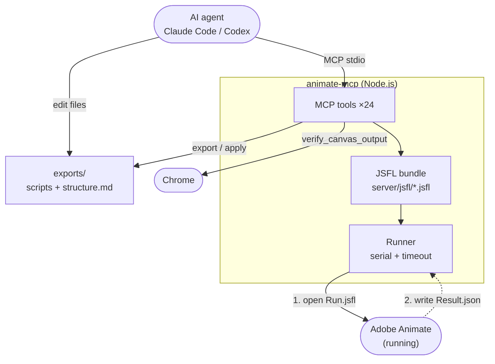

<div align="center">

# animate-mcp

An MCP server for operating Adobe Animate from AI agents.

English | [日本語](README.ja.md)

[Changelog](CHANGELOG.md)

[](https://github.com/gekkyo/animate-mcp/actions/workflows/ci.yml)
[](https://modelcontextprotocol.io)
[](https://www.npmjs.com/package/animate-mcp)
[](LICENSE)

</div>

---

## Overview

`animate-mcp` is an MCP server that lets AI agents such as Claude Code and Codex operate Adobe Animate directly.

Just give the AI instructions in plain language to write and edit frame scripts, work with animations, and automate repetitive tasks.

It reads the structure and scripts of scenes and library symbols so it can edit with an understanding of what is already there, and it supports a wide range of operations, including layers, frames, tweens, instance properties, and library assets. It can also publish a document and capture a frame as a PNG image.

## Highlights

- AI agents can read frame scripts and structure from scenes and library symbols through files, then apply edited scripts back to Animate.
- Inspect layers, keyframes, instances, and tweens.
- Add and edit whole text fields, including font, size, color, alignment, and text type.
- Edit instance transforms, color effects, filters, names, blend modes, and visibility on keyframes.
- Edit layer and frame structure and labels.
- Create motion and classic tweens with preset or custom Bézier easing.
- Organize library folders and items and find unused items.
- Import images and audio, find direct Library usages, create or duplicate symbols, and change stage properties.
- Publish AS3 and HTML5 Canvas documents and get AS3 compile errors and warnings back.
- Read Animate's diagnostic panels and run an AS3 Test Movie to capture runtime output.
- Capture a frame or range as PNG images.
- Check for unused Library items and empty keyframes.
- Verify Canvas HTML in Chrome and compare captured PNGs.
- Install GreenSock-AS3 with a prompt.
- Work with ActionScript 3 and HTML5 Canvas, and run arbitrary JSFL.

## How it works



Each tool builds a JSFL script, writes it to `~/.animate-mcp/runs/`, and opens it in the running Animate. The script writes its result as JSON, which the server reads back. Runs are serialized and time out if Animate does not respond.

## Requirements

- Node.js
- Adobe Animate (must be running)
- An MCP-compatible client (Claude Code, Claude Desktop, etc.)
- Verified with Animate 2027 on macOS and with Animate on Windows.

## Install

### Claude Code

    claude mcp add animate-mcp -- npx -y animate-mcp@latest

### Clients configured with JSON (Claude Desktop, etc.)

    {
      "mcpServers": {
        "animate-mcp": {
          "command": "npx",
          "args": ["-y", "animate-mcp@latest"]
        }
      }
    }

## Usage

1. Start Animate and open the target .fla.
2. Ask your agent to do the work.
3. When editing scripts, the workflow is:
    1. `export_scripts` writes the structure and every frame script to `~/.animate-mcp/exports/<document name>/`.
    2. The agent edits the files.
    3. `apply_scripts` writes them back into Animate.

### Example prompts

#### Script operations

```text
Export the scripts from the open document and find the cause of an error
```

#### Inspecting the timeline

```text
Check the instance and tween on frame 12 of the Character layer in Scene 1
```

#### Editing layers and frames

```text
Add a Background layer to Scene 1 and extend it to 24 frames
```

#### Creating a tween

```text
Move the Ball instance 200 px to the right over frames 1–24 in Scene 1, using backOut easing (overshoot and return)
```

#### Editing instance properties

```text
Set the Ball instance on frame 1 of Scene 1 to 50% alpha and add a blur filter
```

#### Publishing

```text
Publish the open document and tell me the compile errors
```

#### Capturing a frame

```text
Capture frame 12 of Scene 1 and tell me how it looks
```

#### Organizing the library

```text
List unused library items
```

#### Installing GreenSock

```text
Install GreenSock-AS3 for the open document
```

## Usage tips

- If multiple documents are open, specify the target document.
- Changes made in Animate after Export are detected as conflicts during Apply. Apply is refused if the library has changed.
- Re-exporting is refused when unapplied edits exist. Use `force: true` only if you are willing to discard them.
- After changing the timeline, tweens, or library, re-export before editing or applying scripts.
- Deleting a layer, frames, or a library item requires `confirm: true`. Library items in use cannot be deleted.
- Save with `save_document` after confirming any overwrite, or save in Animate. Use `edit_library`'s `getLinkage` and `setLinkage` operations to inspect or edit AS3 linkage; renaming or moving an item still does not automatically update linkage names or string references in code.
- `edit_elements` rejects tween interiors and validates all operations before writing; it does not save the `.fla`.

## Tools

Full inputs and caveats are in [TOOLS.md](TOOLS.md).

| Area | Tool | What it does |
|------|------|--------------|
| Document | `get_document_info` | Show name, size, frame rate, and AS version |
|  | `open_document` | Open a `.fla` or create a new document |
|  | `save_document` | Save a document |
|  | `close_document` | Close a document without saving |
|  | `set_document_properties` | Set stage size, frame rate, and background color |
|  | `audit_document` | List unused Library items and empty keyframes |
| Scripts | `export_scripts` | Export frame scripts and structure to files |
|  | `apply_scripts` | Apply edited scripts back to Animate |
| Timeline and elements | `inspect_timeline` | Read layers, keyframes, instances, and tweens |
|  | `edit_timeline` | Edit layers, frames, keyframes, and labels |
|  | `edit_tween` | Create tweens and change easing |
|  | `edit_elements` | Edit or place symbol instances |
|  | `edit_text` | Add and edit text fields |
|  | `convert_to_symbol` | Convert elements to a symbol |
| Library | `edit_library` | Organize items, find usages, edit AS3 linkage |
|  | `import_assets` | Import images and audio into the Library |
| Output and verification | `publish` | Publish and return the Build result |
|  | `read_output` | Read the Output and Compiler Errors panels |
|  | `test_movie` | Run an AS3 Test Movie and capture its output |
|  | `verify_canvas_output` | Open Canvas output in Chrome and check for errors |
|  | `capture_frame` | Capture a frame or range as PNG |
|  | `diff_captures` | Compare two captured PNGs |
| Other | `install_greensock` | Install GreenSock-AS3 |
|  | `run_jsfl` | Run arbitrary JSFL |

## Environment variables

| Name                          | Description                                  | Default               |
|-------------------------------|----------------------------------------------|-----------------------|
| `ANIMATE_MCP_TIMEOUT_MS`      | Execution timeout                            | 30000                 |
| `ANIMATE_MCP_RUNS_DIR`        | Working directory                            | `~/.animate-mcp/runs` |
| `ANIMATE_MCP_LAUNCH_COMMAND`  | Custom command to open the `.jsfl` file      | OS default            |
| `ANIMATE_MCP_PROCESS_PATTERN` | Custom process pattern to detect Animate     | OS default            |

## Bug reports

Please open an [issue](https://github.com/gekkyo/animate-mcp/issues) with your Animate version, OS, steps to reproduce and error messages.

## Development

    npm install && npm run build
    npm test

Client config: `node /path/to/animate-mcp/server/dist/index.js` (stdio).

### Manual smoke test (real Animate)

1. Start Animate with a document open.
2. Run `run_jsfl` with `fl.trace('hi'); 'ok'`. `hi` appears in the Output panel and the tool returns `"ok"`. Animate comes to the front (known behavior).
3. Run `get_document_info`. It returns name, size, frame rate and timeline names.
4. Close all documents and run `get_document_info`. It returns "No document open".
5. Quit Animate and run `run_jsfl`. It returns "Animate not running".
6. With a saved AS3 document open, run `publish`. It returns `ok: true` with empty `errors`. Add a syntax error and run it again to see it in `errors`.
7. Run `capture_frame`. It returns a PNG image and its saved path.
8. Unverified: behavior while a modal dialog is open.

Scripted versions of steps 6–7 and tool checks: run `npm run build`, then `node server/scripts/smoke-publish.mjs`, `smoke-capture-frame.mjs`, `smoke-edit-elements.mjs`, `smoke-edit-library.mjs`, `smoke-edit-text.mjs`, and `smoke-import-document-properties.mjs` with Animate available. `node server/scripts/smoke-test-movie.mjs` creates and closes a disposable AS3 FLA; it leaves the Test Movie Player open for you to close manually. `smoke-document-ops.mjs` (AS3) and `smoke-canvas.mjs` (HTML5 Canvas) each create, exercise and close a disposable saved FLA.

## License

[MIT License](LICENSE)
